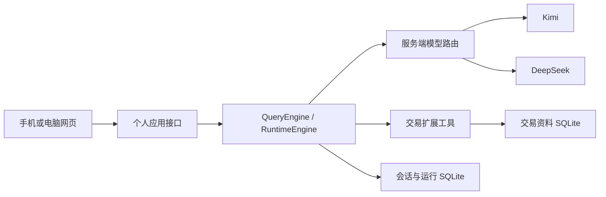

# 最小版功能与架构

适用范围：个人使用、单实例、手机与电脑网页，优先完成真实对话和可找回的记忆。完整历史方案留在data/backups/cleanup-20261003/old-docs/design.md。

## 功能

| 入口 | 当前能力 |
|---|---|
| 对话 | 文字、语音转文字、图片和文档，真实工具循环、流式回复、原话绑定 |
| 模型 | Kimi、DeepSeek Flash/Pro、自定义兼容模型；网页切换并保存选择 |
| 历史 | 同一会话可跨模型继续；原用户消息、附件与最终回复可找回和继续追问 |
| 知识库 | 整理成果、待打磨、资料档案与经典书架；主题/类型/收藏/待回查筛选，归档管理、来源与版本追溯 |
| 交易体系 | 道：目标与认同原则；法：纪律与提案；术：工作技能与方法；器：仓位计算、行情、台账、纪律检查 |
| 运维 | 原数据只读导入、一致性SQLite备份、独立发布、服务重启恢复 |

记忆开关只决定业务资料是否写入，聊天历史仍保存；已有请求重试返回已缓存结果，失败或中断不自动重放工具写入。一次只处理一个请求。

## 结构与职责

`cloud_trading/app.py`管理个人登录、历史、模型选择、请求缓存与SSE；`models.py`读取模型列表、加载服务端密钥并按消息路由；`runtime.py`装配核心、交易扩展和技能。

`attachments.py`独立管理文件保存、图片规范化、文档提取和按需离线语音转写。利用核心已有resolved_attachments进入当前查询；核心历史恢复优先读text，模型路由扩展在供应商调用前恢复对应用户消息的附件块，再按协议装配图片。数据库保留文字与附件引用，图片base64不写入会话数据库。历史附件恢复按逆序匹配相同原话，保持重复说明文字的对应文件与顺序；读取总量有明确上限。

`vendor/runtime_core`保留原引擎121个动态/静态导入依赖模块，原包名和源码字节不变，manifest.json提供校验值。原审计平台入口、前端、法规库和业务扩展未纳入运行工程。交易场景提示和工具不写入核心。

`trading_agent`维持原业务对象、版本、更正与引用机制；五个技能提供任务流程，道法术器按任务执行。没有四个常驻独立模型。

## 模型配置与切换

模型公开配置为`config/models.toml`，仅保存ID、名称、协议、地址和密钥环境项名称。密钥保存在`config/app.env`。兼容OpenAI Chat Completions及Anthropic Messages；没有模拟回答或静默自动换模型。

选择写入runtime/settings.json；新消息在提交时固定模型ID。工具循环的后续调用继续使用该ID，服务端内部metadata不作为供应商metadata外传。Kimi工具结果的JSON按Anthropic可接受格式序列化，原业务工具和持久化正文保持原样。

DeepSeek模型名依官方接口当日返回的deepseek-flash、deepseek-v4-pro配置，使用OpenAI兼容协议：[官方调用说明](https://api-docs.deepseek.com/)。未来可在TOML中更新名称或加入其他供应商。

## 数据边界

- 网页业务资料：data/cloud/trading/knowledge.sqlite。
- 网页聊天运行：data/cloud/runtime/runtime.sqlite；模型选择另存settings.json。
- 知识库归档、主题和收藏：data/cloud/runtime/library.sqlite，独立于业务事实与纪律，纳入一致性备份。
- 聊天附件：data/cloud/runtime/attachments，每份文件的原件、预览与提取内容分目录保存；随聊天资料一起备份。未发送附件的卡片移除只撤销本次发送选择，文件不会立刻物理删除。
- 离线语音模型：runtime/models/faster-whisper-base，按需加载，发布时单独安装，不放入代码包或每次资料备份。
- 原MCP资料：data/trading，保留为原本资料副本。
- 经典、角色、技能随代码发布；个人资料与密钥单独处理。

云端和本机不做双向同步，日常使用应选择一个权威写入入口。当前公开行情源沿用既有实现和缺口，未把历史行情验收等同于云端实时行情可用。

## 当前边界

未实现常驻监控、自动通知、自动下单、券商同步、完整缠论、全市场选股、完整企业资料联网研究及独立规则发布工作台。扫描 PDF 文字识别、视频理解及旧版 Office 文件暂不支持。录音识别只把转写文本交给语言模型，图片和文件按用户选定模型发送；HTTP 页面不能直接取得麦克风。候选认识不自动变成正式纪律，程序验收不证明交易方法有效。

界面组织、阅读层次和交互规范见[产品设计](product-design.md)。`library.py`保留旧网页的只读分类；`knowledge.py`提供成果层级和独立归档偏好；`workspace.py`提供实际技能目录、工具目录与纪律表单，不改写业务对象。
